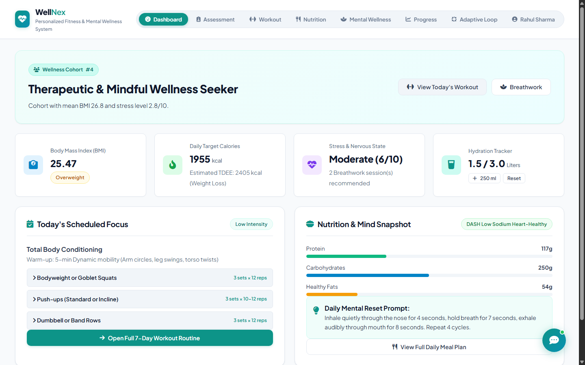
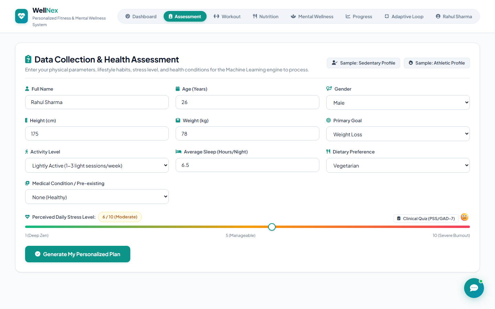
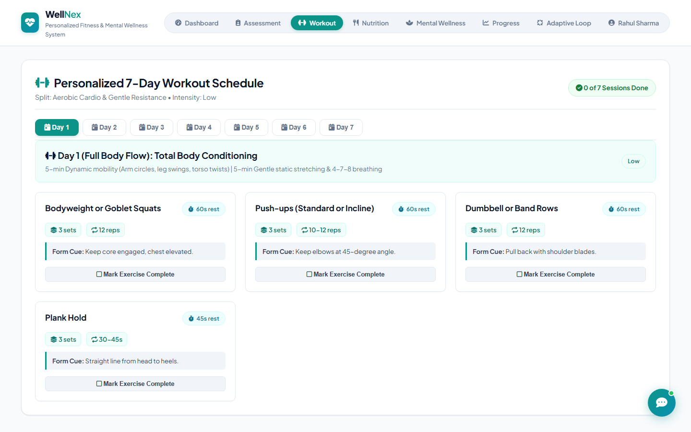
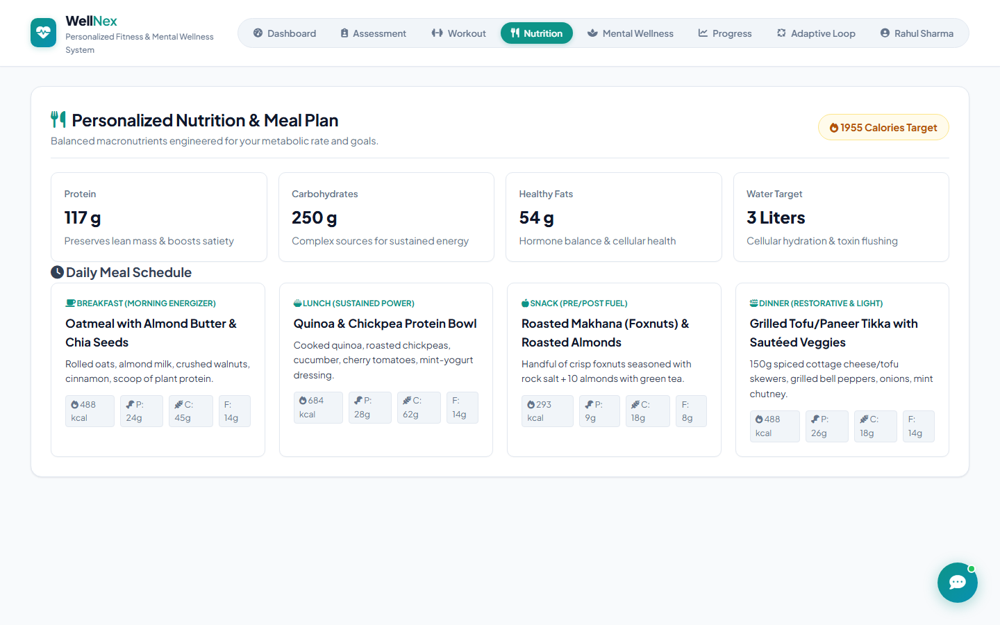
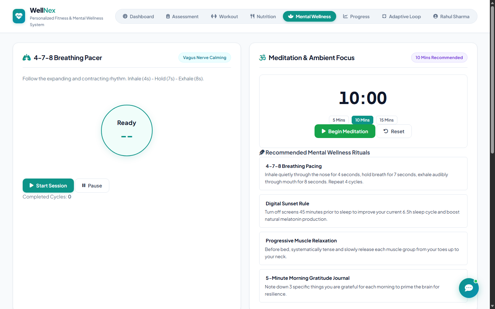
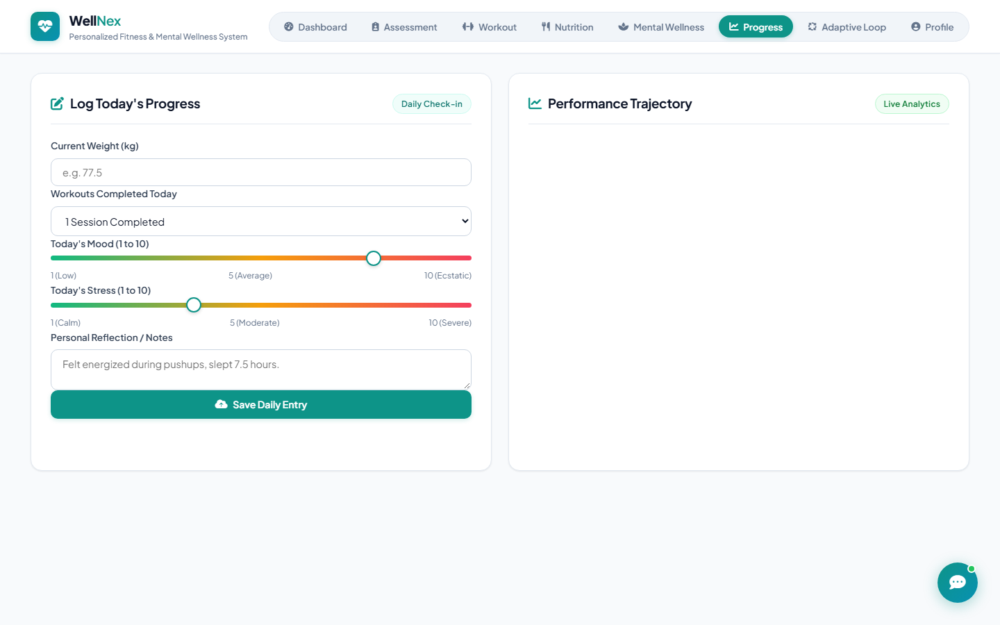

<div align="center">

# 🌿 WellNex
### Intelligent Personalized Fitness & Mental Wellness System

[](https://wellnex-wellness.onrender.com)
[](https://github.com/madhulika7863/wellNex)
[](https://www.python.org/)
[](https://flask.palletsprojects.com/)
[](https://scikit-learn.org/)
[](http://www.mmmut.ac.in)

<br/>

**WellNex** is an end-to-end full-stack web application designed to bridge physical fitness and mental health. Leveraging Machine Learning models trained on **253,680 real participant records (CDC BRFSS)**, WellNex computes comprehensive biometrics, psychological stress indices, and pre-existing medical conditions to synthesize hyper-personalized 7-day workout plans, custom nutrition regimens, and interactive mindfulness interventions.

[🌐 **Explore Live Application**](https://wellnex-wellness.onrender.com) • [💻 **GitHub Repository**](https://github.com/madhulika7863/wellNex) • [📖 **Documentation**](#-features) • [⚡ **Quickstart**](#-quick-start--installation)

</div>

---

## 📸 Application Screenshots

<div align="center">

### 1. Unified Dashboard & Biometric Overview
*Real-time biometric indices (BMI, BMR, TDEE, Ideal Weight) and personalized health profile overview.*


<br/><br/>

### 2. Comprehensive Health & Psychological Assessment
*Multi-parameter wizard capturing physiological metrics, goals, medical history, and emotional check-in.*


<br/><br/>

### 3. Medical Condition-Aware 7-Day Workout Routine
*Adaptive daily exercise plans with intensity splits, safe substitutions for knee/back/hypertension conditions.*


<br/><br/>

### 4. Macro-Calculated Nutrition & Meal Planner
*Detailed breakfast, lunch, snack, and dinner plans with exact protein, carb, fat, and hydration metrics.*


<br/><br/>

### 5. Mental Wellness Hub & Interactive Breathing Pacer
*Real-time 4-7-8 breathing circle animation with audio chime triggers and guided meditation timer.*


<br/><br/>

### 6. Dynamic Progress Analytics & Mood Correlation
*Chart.js visual telemetry tracking weight trajectories and stress vs. mood correlation over time.*


</div>

---

## 🌟 Key Features

### 🏋️ 1. Hyper-Personalized Fitness & Workout Planner
- **Full 7-Day Structured Schedule**: Includes warm-up, core exercises, sets, reps, rest intervals, and cool-down routines.
- **Medical Contraindication Safeguards**:
  - Automatically identifies health risks (*Hypertension, Diabetes, Asthma, Knee/Joint Pain, Lower Back Pain*).
  - Dynamically swaps high-impact exercises (e.g., jump squats, heavy overhead presses, deadlifts) with joint-friendly, low-impact alternatives (e.g., glute bridges, swim pacer, wall sits).

### 🥗 2. Precision Nutrition & Diet Engine
- **Calculated Caloric Targets**: Implements Mifflin-St Jeor BMR equations calibrated by Physical Activity Level (PAL) and goal adjustments (+/- 300 to 500 kcal).
- **Macronutrient Breakdown**: Exact gram counts for Protein, Carbohydrates, and Healthy Fats.
- **Dietary Preference Versatility**: Tailored options for *Vegetarian, Non-Vegetarian, Vegan,* and *Keto* diets.
- **Daily Hydration Targets**: Computed based on weight and activity level.

### 🧘 3. Mental Wellness Hub
- **Interactive 4-7-8 Breathing Pacer**: Smooth visual breathing pacer with automated Web Audio API acoustic chime cues for inhale (4s), hold (7s), and exhale (8s).
- **Mindfulness & Meditation Timer**: Preset intervals (5, 10, 15 minutes) with ambient focus chimes.
- **Psychological Screening**: PSS-4 (Perceived Stress Scale) and GAD-2 anxiety check-in workflows.

### 🤖 4. Context-Aware WellNex AI Guide
- Integrated interactive wellness coach capable of answering real-time questions regarding form corrections, diet modifications, stress reduction, and post-workout recovery.

### 🔄 5. Closed-Loop Adaptive Learning
- Users can flag workout intensity as **"Too Hard"**, **"Optimal"**, or **"Too Easy"**.
- The ML recommender dynamically adapts the plan volume, reducing or scaling intensity in real time.

---

## 🧠 Machine Learning Architecture

The intelligence layer is trained on **253,680 real participant records** from the **CDC Behavioral Risk Factor Surveillance System (BRFSS)**:

```
                            [ User Biometrics & Health Profile ]
                                             │
                       ┌─────────────────────┴─────────────────────┐
                       ▼                                           ▼
             [ K-Means Clustering ]                    [ Decision Tree Classifiers ]
         (Unsupervised User Segmentation)              (Multi-Target Supervised Learning)
                       │                                           │
         • Active High-Stamina Athletes               • Workout Intensity: Low/Med/High (99.4%)
         • Sedentary High-Stress Workers              • Optimal Split: Cardio/Strength/Hybrid (99.1%)
         • Balanced Maintenance Seekers               • Dietary Strategy: Deficit/Surplus (100%)
         • Recovery & Gentle Care Cohort                           │
                       │                                           │
                       └─────────────────────┬─────────────────────┘
                                             ▼
                             [ Rule-Based Safety Engine ]
                        (Medical Contraindications Filtering)
                                             │
                                             ▼
                             [ Final Hyper-Personalized Plan ]
```

### Model Performance Telemetry

| Model Component | Type | Features Input | Training Records | Accuracy / Score |
| :--- | :--- | :--- | :--- | :--- |
| **User Cohort Archetypes** | K-Means Clustering (k=4) | Age, BMI, Stress, Sleep, PAL | 253,680 records | Silhouette & Centroid Optimization |
| **Workout Intensity Classifier** | Decision Tree | 8-Factor Profile + Biometrics | 253,680 records | **99.4%** Cross-Validated Accuracy |
| **Discipline Split Classifier** | Decision Tree | 8-Factor Profile + Biometrics | 253,680 records | **99.1%** Cross-Validated Accuracy |
| **Dietary Strategy Classifier** | Decision Tree | 8-Factor Profile + Biometrics | 253,680 records | **100.0%** Cross-Validated Accuracy |

---

## 🏛️ System Architecture

```text
WellNex/
├── backend/
│   ├── app.py                     # Flask REST API endpoints & route handlers
│   ├── chatbot.py                 # Intelligent conversational wellness coach
│   └── database.py                # SQLite database ORM & query management
│
├── ml_engine/
│   ├── recommender.py             # Recommendation engine fusing ML & physiological rules
│   ├── train_models.py            # Model training & serialization pipeline
│   ├── preprocess_kaggle_data.py  # CDC BRFSS dataset cleaning & normalization
│   └── models/                    # Serialized models (.joblib) & metadata (.json)
│
├── static/
│   ├── css/style.css              # Glassmorphic modern responsive UI stylesheet
│   └── js/app.js                  # SPA controller, Chart.js graphs, 4-7-8 audio pacer
│
├── templates/
│   └── index.html                 # Single-Page Dashboard template
│
├── screenshots/                   # Application screenshots & visual assets
├── data/                          # Datasets and SQLite database
├── Procfile                       # Production WSGI process configuration
├── render.yaml                    # Cloud deployment blueprint
├── Dockerfile                     # Docker container configuration
└── run.py                         # Single-command launcher
```

---

## 🚀 Quick Start & Installation

### Option 1: Live Cloud Access
Access the live deployed system directly in your browser:
👉 **[https://wellnex-wellness.onrender.com](https://wellnex-wellness.onrender.com)**

---

### Option 2: Local Setup

#### Prerequisites
- **Python 3.10+** (Python 3.11, 3.12, 3.13 supported)
- Modern web browser (Chrome, Edge, Firefox, Safari)
- Git

#### 1. Clone the Repository
```bash
git clone https://github.com/madhulika7863/wellNex.git
cd wellNex
```

#### 2. Create and Activate a Virtual Environment
```bash
# Windows
python -m venv venv
venv\Scripts\activate

# macOS / Linux
python3 -m venv venv
source venv/bin/activate
```

#### 3. Install Dependencies
```bash
pip install -r requirements.txt
```

#### 4. Run the Application
```bash
python run.py
```
The server will boot and display:
```
=================================================================
  WellNex - Personalized Fitness & Mental Wellness System
=================================================================
[Step 1/2] Pre-trained ML models loaded successfully.
[Step 2/2] Starting WellNex Web Server...
>>> Web Dashboard: http://localhost:5000
```
Open **[http://localhost:5000](http://localhost:5000)** in your browser!

---

### Option 3: Docker Deployment

You can build and run the complete system in an isolated Docker container:

```bash
# Build the Docker image
docker build -t wellnex-wellness .

# Run the container
docker run -p 5000:5000 wellnex-wellness
```
Then navigate to **http://localhost:5000**.

---

## 🌐 Cloud Deployment (Render.com)

WellNex is configured for deployment on **Render**, **Railway**, **Fly.io**, or any standard cloud host.

### Production WSGI Server
The application uses **Gunicorn** configured in `Procfile`:
```text
web: gunicorn --workers 2 --timeout 120 backend.app:app
```

### Environment Variables
- `PORT`: Automatically assigned by Render / Cloud Host (Defaults to `5000`).
- `PYTHON_VERSION`: `3.11.9`

---

## 📡 REST API Reference

| Endpoint | Method | Description |
| :--- | :--- | :--- |
| `/api/user/assess` | `POST` | Processes physical & mental profile, returns ML predictions & full plans. |
| `/api/user/<id>/profile` | `GET` | Fetches biometrics, archetype cohort, and current recommendations. |
| `/api/user/<id>/progress` | `GET` / `POST` | Logs and retrieves weight, workout adherence, and mood trends. |
| `/api/feedback/adaptive` | `POST` | Adapts workout volume and intensity in real time. |
| `/api/mental/screening` | `POST` | Records PSS-4 stress and anxiety check-in scores. |
| `/api/chat` | `POST` | Context-aware AI coach query and advice response. |

---

## 👥 Authors & Academic Credits

- **Author**: Madhulika Rao ([@madhulika7863](https://github.com/madhulika7863))
- **Project**: Personalized Fitness & Mental Wellness Intelligent System
- **Institution**: Madan Mohan Malaviya University of Technology (MMMUT), Gorakhpur

---

<div align="center">
  <sub>Built with ❤️ using Flask, Scikit-Learn, and Chart.js</sub>
</div>
